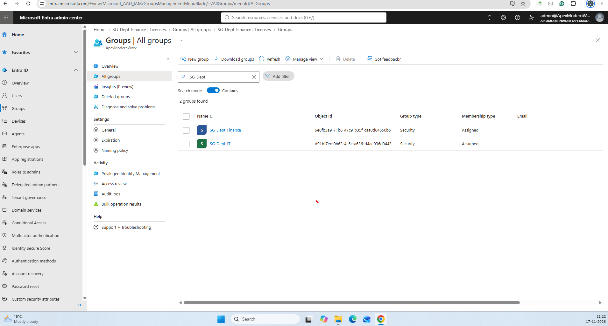
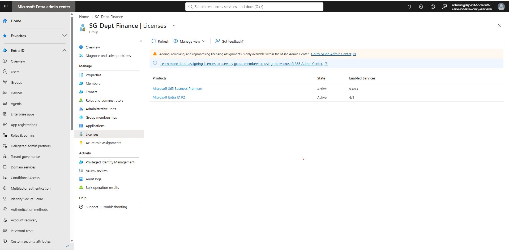
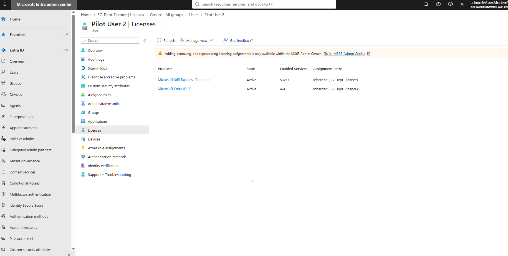
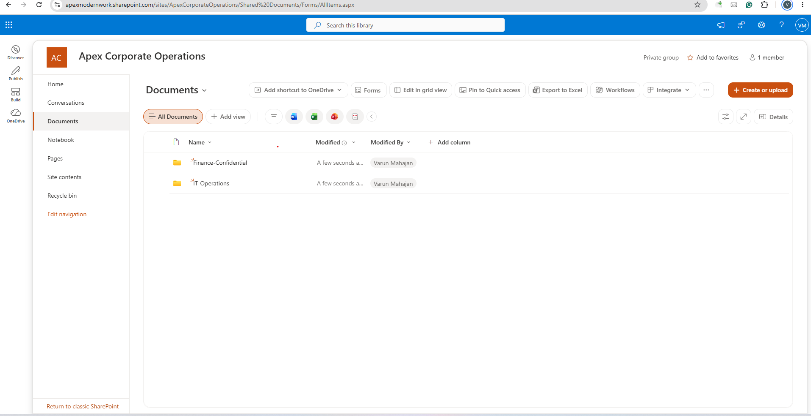
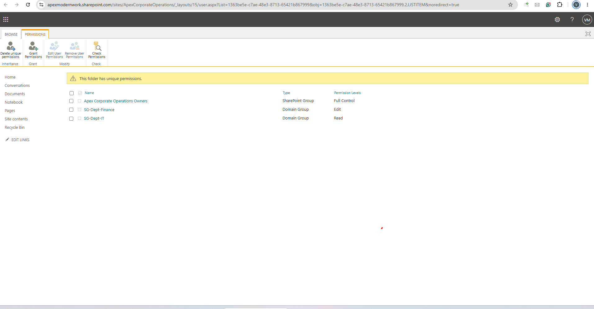
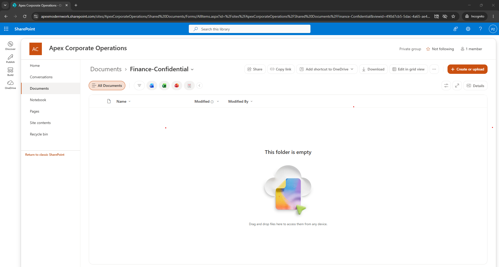

# Microsoft 365 Department RBAC, Group-Based Licensing & SharePoint Governance Lab

Enterprise Role-Based Access Control (RBAC), automated group-based license provisioning, and SharePoint permission inheritance governance lab built on **Microsoft Entra ID**, **Microsoft 365 Admin Center**, and **SharePoint Online** within the `ApexModernWork.onmicrosoft.com` tenant.

## Repository Structure

```text
Enterprise-M365-Department-RBAC-Governance-Lab/
├── 01-Department-Groups-And-Licensing/
│   ├── 01-department-security-groups.png
│   ├── 02-group-based-licensing-assignment.png
│   └── 03-user-license-inherited-status.png
├── 02-SharePoint-RBAC-And-Inheritance/
│   ├── 04-sharepoint-department-folders.png
│   ├── 05-sharepoint-broken-inheritance-rbac.png
│   └── 06-sharepoint-access-validation.png
└── README.md
```

## Architecture Overview

This lab demonstrates standardized departmental access governance and least-privilege file isolation:

1. **Department Security Groups (`SG-Dept-IT` & `SG-Dept-Finance`):** Created assigned Entra ID security groups for departmental segmentation (`pilotuser1` in IT; `pilotuser2` in Finance).
2. **Automated Group-Based Licensing:** Assigned **Microsoft 365 Business Premium** and **Microsoft Entra ID P2** directly to `SG-Dept-Finance`, verifying automatic inherited license provisioning (`Inherited (SG-Dept-Finance)`) on member accounts.
3. **SharePoint Site & Department Document Structure:** Provisioned the `Apex Corporate Operations` team site and structured departmental folders (`IT-Operations` and `Finance-Confidential`) inside the `Documents` library.
4. **Broken Permission Inheritance & Least-Privilege RBAC:** Broke permission inheritance on `Finance-Confidential`, removed broad site member/visitor groups, and enforced explicit group-based permissions (`SG-Dept-Finance`: **Edit**, `SG-Dept-IT`: **Read**), validated via live `pilotuser2` (`P2`) and `pilotuser1` (`P1`) session testing.

---

## Lab Evidence & Artifacts

### 01. Department Security Groups & Group-Based Licensing

* **#01 Department Security Groups (`SG-Dept-IT` & `SG-Dept-Finance`):** Configured assigned Entra ID security groups to decouple user lifecycle management from direct resource and license assignments.



* **#02 Group-Based Licensing Assignment (`SG-Dept-Finance`):** Assigned Microsoft 365 Business Premium (53/53 services) and Microsoft Entra ID P2 (4/4 services) at the group level (`State: Active`).



* **#03 Inherited User License Verification (`Pilot User 2`):** Verified automatic license inheritance (`Inherited (SG-Dept-Finance)`) without manual per-user assignment.



---

### 02. SharePoint RBAC & Permission Inheritance Governance

* **#04 SharePoint Department Document Folders:** Created `IT-Operations` and `Finance-Confidential` directories inside `Apex Corporate Operations > Documents`.



* **#05 Broken Permission Inheritance & Explicit Group RBAC:** Isolated `Finance-Confidential` with unique permissions (`SG-Dept-Finance`: Edit, `SG-Dept-IT`: Read) and stripped inherited site-wide groups.



* **#06 End-User Department Access Validation (`pilotuser2` / `SG-Dept-Finance`):** Confirmed `pilotuser2@ApexModernWork.onmicrosoft.com` receives elevated **Edit** (`+ Create or upload`) privileges inside `Finance-Confidential` despite holding only site-level `Read` visitor permissions.


